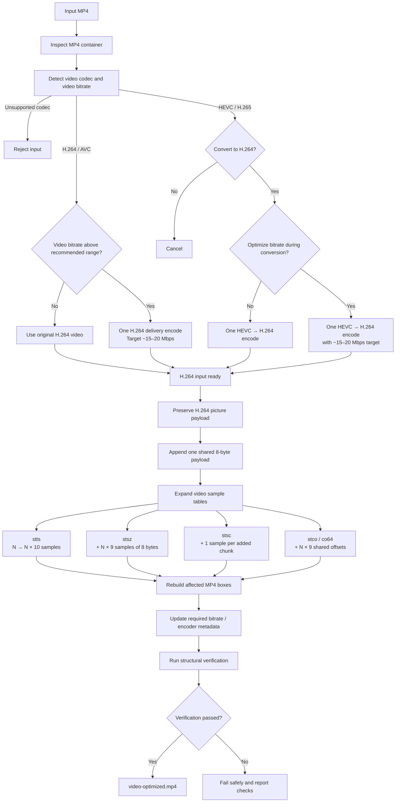

# tk-optimize

[](https://img.shields.io)
[](https://img.shields.io)
[](https://img.shields.io)
[](https://img.shields.io)

A local MP4 optimizer designed to reduce TikTok's aggressive video recompression by transforming the MP4 container structure before upload.

`tk-optimize` preserves the original H.264 video payload and applies a deterministic MP4/container transformation that has been experimentally verified to reproduce the target upload behavior.

For H.264 input, the video is **not re-encoded**. The transformation operates on MP4 sample tables, chunk mappings, offsets, metadata, and container layout while preserving the original picture data.

HEVC/H.265 input is supported through an optional H.264 preprocessing step using FFmpeg.

> **Important:** `tk-optimize` does not improve the underlying camera footage. It prepares the MP4 for a different upload behavior. The visual result still depends on the source quality and TikTok's current processing pipeline.

- **H.264/AVC input** → transformed directly.
- **HEVC/H.265 input** → asked whether to preprocess to H.264 (via FFmpeg),
  then transformed.
- **Optional bitrate optimization.** When the source video bitrate is above
  the recommended delivery range (default 15–20 Mbps), a single rate-capped
  H.264 delivery encode is offered before the transformation.
- **No re-encoding of H.264 by the transformation.** The transformation is
  pure byte-level box surgery; media is copied verbatim. Encoding happens
  only in the optional pre-steps (HEVC→H.264 conversion and bitrate
  optimization), never inside the MP4 transformation.
- **Fully dynamic.** Every value (counts, offsets, bitrates) is derived from
  the input — nothing is reference-specific.
- **Deterministic.** Same input bytes ⇒ same output bytes.
- **Verified.** A structural verifier re-parses every output and checks each
  invariant (sample tables, chunk mappings, offsets, shared tail, metadata),
  and the shipped regression proves the reference pair is reproduced
  **byte-for-byte**.

## What It Does

The transformation is intentionally simple at the video-data level:

```text
Input MP4
   │
   ├── H.264/AVC ────────────────┐
   │     │                       │
   │     └─ optional delivery    │
   │        bitrate optimize ────┤
   │                             │
   └── HEVC/H.265                │
        │                        │
        └─ H.264 encode (with    │
           optional rate cap) ───┤
                                  ▼
                       MP4 container transformation
                                  │
                                  ├─ preserve original picture data
                                  ├─ extend video sample tables
                                  ├─ add shared non-picture samples
                                  ├─ rebuild chunk mappings
                                  ├─ relocate chunk offsets
                                  ├─ update required bitrate metadata
                                  └─ rebuild affected MP4 boxes
                                  │
                                  ▼
                        video-optimized.mp4
                                  │
                                  ▼
                            TikTok upload
```

The H.264 video payload is preserved byte-for-byte by the MP4 transformation
itself. The transformation changes how the video samples are represented
inside the MP4 container rather than re-encoding the pictures. The only
video encoding is the optional pre-step: a HEVC→H.264 conversion and/or a
rate-capped delivery encode when bitrate optimization is chosen.

## What It Does Not Do

`tk-optimize` does **not**:

- upscale video;
- increase real image detail;
- interpolate frames;
- sharpen footage;
- denoise footage;
- apply LUTs or color grading;
- resize 1080p to 4K;
- re-encode H.264 input **inside the MP4 transformation** (the optional
  bitrate-optimization step, when chosen, runs _before_ the transformation
  and is a single rate-capped H.264 encode);
- guarantee a specific TikTok processing result forever.

It is an **upload-side MP4 transformation**, not a video enhancement tool.

## How It Works



## Recommended Source Video

### Recommended: 1080p

For TikTok uploads, **1080p is the recommended source resolution**.

A practical target is:

- **Resolution:** 1080p
- **Frame rate:** 120 FPS when available
- **Alternative FPS:** 30 or 60 FPS
- **Codec:** H.264 preferred when available
- **Aspect ratio:** preserve the original camera orientation

Higher resolutions such as 1440p or 4K are intentionally not recommended by default.

The optimization does not create additional visual detail. Starting with a 4K source mainly increases:

- file size;
- upload time;
- local processing time;
- temporary storage requirements.

For typical vertical TikTok consumption, a well-prepared 1080p source provides a much better size-to-quality trade-off.

> **Practical recommendation:** use **1080p 120 FPS** when your source footage supports it. 1080p 60 FPS and 1080p 30 FPS are also valid.

## Playback Note

Videos produced by this workflow may take a few seconds to begin playback the first time they are opened in TikTok.

In testing, the first playback could remain on the thumbnail for approximately **3–5 seconds** before starting normally.

After the video has been loaded once, subsequent opens in the same app session were observed to start normally.

This behavior was observed independently across multiple devices and networks.

It does not indicate a problem with the generated MP4 itself; the output remains playable locally and passes the structural verification performed by `tk-optimize`.

## Supported Codecs

| Input                                    | Behavior                                                                        |
| ---------------------------------------- | ------------------------------------------------------------------------------- |
| **H.264 / AVC** (`avc1`, `avc2`, `avc3`) | Direct transformation. Optionally a delivery bitrate-optimization encode first. |
| **HEVC / H.265** (`hvc1`, `hev1`)        | FFmpeg conversion to H.264 (with optional rate cap), then transformation.       |
| Other codecs                             | Rejected                                                                        |

Codec detection is performed from the actual MP4 video track metadata, not from the file extension.

> **HEVC note:** HEVC → H.264 is a compatibility preprocessing step, not part of the MP4 transformation itself. Because it requires video re-encoding, it introduces an additional generation loss. H.264 input is therefore preferred when available.

> [!WARNING]
>
> ### Avoid 1440p / 4K unless you have a specific reason
>
> `tk-optimize` does not upscale or enhance source footage.
>
> Feeding a 2K/4K source mainly increases file size and processing/upload cost without guaranteeing a better TikTok viewing result.
>
> For this workflow, **1080p is the recommended target resolution**, with **1080p 120 FPS** being the preferred profile when available.

### HEVC → H.264 policy

Only the video codec changes. Preserved: width, height, frame rate, duration,
aspect ratio, colour metadata (primaries/transfer/matrix/range), interlacing,
and orientation (`-noautorotate` — rotation metadata is kept, not applied).
Audio is **stream-copied** (`-c:a copy`). No resizing, cropping, filters,
sharpening, or LUTs.

The conversion is conceptually equivalent to:

```bash
ffmpeg -noautorotate -i INPUT \
       -map 0:v:0 -map 0:a? \
       -c:v libx264 -preset slow -crf 16 -pix_fmt yuv420p \
       -c:a copy OUTPUT
```

plus colour-metadata/interlacing flags adapted from the source.

## Bitrate optimization (optional delivery encode)

When the source video bitrate is above the recommended delivery range
(default **15–20 Mbps**, configurable via `TK_RECOMMENDED_MIN_BITRATE_MBPS` /
`TK_RECOMMENDED_MAX_BITRATE_MBPS`), the CLI offers to run a single
**rate-capped H.264 delivery encode** before the MP4 transformation:

    [!] this is above the recommended delivery range
    [+] recommended delivery range: 15-20 Mbps
    [+] estimated video size: ~238.2 MB
    [?] optimize video bitrate? [Y/n]:

The bitrate is read from the FFprobe video-stream metadata; when it is
unavailable or FFmpeg is missing the analysis is skipped gracefully.
Choose **Y** to run the delivery encode, **N** to keep the source bitrate
(the H.264 picture data is then untouched).

Routing rules:

- **H.264 below the range** → no encode; the transformation runs directly.
- **H.264 above the range** → exactly one delivery encode, then transform.
- **HEVC** → the HEVC→H.264 conversion is always a single encode; bitrate
  optimization, when chosen, is folded into that encode via a rate cap
  (never a second H.264 encode). "Keeping the source bitrate" means no
  delivery rate cap, not bit-for-bit preservation.

The delivery encode is equivalent to:

```bash
ffmpeg -noautorotate -i INPUT \
       -map 0:v:0 -map 0:a? \
       -c:v libx264 -preset slow -crf 18 -pix_fmt yuv420p \
       -maxrate 20M -bufsize 20M \
       -c:a copy OUTPUT
```

Resolution, frame rate, duration, aspect ratio, colour metadata, interlacing
and orientation are preserved (same flags as the HEVC→H.264 step), audio is
stream-copied, and the encoded file is re-probed to verify codec, geometry,
timing and audio count before the transformation runs. The output is then
validated by the standard structural verifier.

| Flag                    | Meaning                                           |
| ----------------------- | ------------------------------------------------- |
| `--optimize-bitrate`    | always apply the delivery encode (no prompt)      |
| `--no-optimize-bitrate` | never apply the delivery encode (no probe/prompt) |
| `--target-bitrate MBPS` | delivery target bitrate (default: 20)             |
| `--crf N`               | delivery encode CRF, 0-51 (default: 18)           |
| `--preset NAME`         | delivery encode preset (default: slow)            |

## FFmpeg discovery

FFmpeg and FFprobe are located at runtime (no hard-coded OS paths), in order:

1. **Environment override** — `TK_FFMPEG`, `TK_FFPROBE`
2. **`PATH`** — via `shutil.which()`
3. **Platform fallbacks** — common install locations
   (e.g. `/usr/local/bin`, scoop/WinGet/Chocolatey dirs on Windows)

```bash
TK_FFMPEG=/usr/local/bin/ffmpeg python3 tk-cli.py sample.mp4
```

If FFmpeg is required (HEVC path, or bitrate optimization) and cannot be
found, the CLI fails with an actionable message. The plain H.264 path (no
optimization) never touches FFmpeg.

## Configuration

Only user preferences are configurable. The algorithm's structural
invariants are fixed and not exposed. Precedence is:

    CLI option > environment variable > built-in default

| Setting                 | Environment                       | CLI flag                                       | Default                |
| ----------------------- | --------------------------------- | ---------------------------------------------- | ---------------------- |
| Output directory        | `TK_OUTPUT_DIR`                   | `--output-dir`                                 | `output/`              |
| HEVC→H.264 encoder      | `TK_H264_ENCODER`                 | —                                              | `libx264`              |
| HEVC→H.264 preset       | `TK_H264_PRESET`                  | —                                              | `slow`                 |
| HEVC→H.264 CRF          | `TK_H264_CRF`                     | —                                              | `16`                   |
| HEVC→H.264 pixel format | `TK_H264_PIX_FMT`                 | —                                              | `yuv420p`              |
| Delivery target bitrate | `TK_DELIVERY_TARGET_MBPS`         | `--target-bitrate`                             | `20`                   |
| Delivery maxrate        | `TK_DELIVERY_MAXRATE_MBPS`        | —                                              | `20`                   |
| Delivery bufsize        | `TK_DELIVERY_BUFSIZE_MBPS`        | —                                              | `20`                   |
| Delivery CRF            | `TK_DELIVERY_CRF`                 | `--crf`                                        | `18`                   |
| Delivery preset         | `TK_DELIVERY_PRESET`              | `--preset`                                     | `slow`                 |
| Recommended range (min) | `TK_RECOMMENDED_MIN_BITRATE_MBPS` | —                                              | `15`                   |
| Recommended range (max) | `TK_RECOMMENDED_MAX_BITRATE_MBPS` | —                                              | `20`                   |
| Bitrate optimization    | —                                 | `--optimize-bitrate` / `--no-optimize-bitrate` | ask (when above range) |

```bash
TK_OUTPUT_DIR=custom-out python3 tk-cli.py sample.mp4
TK_H264_PRESET=medium TK_H264_CRF=18 python3 tk-cli.py sample.mp4
TK_H264_ENCODER=x264 TK_H264_PIX_FMT=yuv444p python3 tk-cli.py sample.mp4
TK_DELIVERY_TARGET_MBPS=18.5 TK_DELIVERY_CRF=22 python3 tk-cli.py sample.mp4
python3 tk-cli.py sample.mp4 --optimize-bitrate --target-bitrate 15 --crf 20 --preset medium
```

The HEVC→H.264 encode settings are validated: the encoder, preset and pixel
format must be non-empty strings, and the CRF must be an integer between 0 and 51. Delivery settings validate the same fields plus positive numeric bitrates
(in Mbps, floats accepted). Invalid values fail fast with a `ConfigError`
rather than being ignored.

## Installation

Python ≥ 3.9 only. The CLI uses `rich` for colored output
(`pip install -r requirements.txt`; the library itself has no third-party
dependencies). `ffmpeg`/`ffprobe` are optional and needed **only** for HEVC
preprocessing, bitrate analysis, and the delivery bitrate-optimization
encode (and for the test suite to auto-generate fixtures).

```bash
git clone <this-repo> && cd tk-optimize
pip install -r requirements.txt
```

## Usage

Run:

    python3 tk-cli.py [INPUT.mp4] [--method NAME] [--output FILE]
                      [--output-dir DIR] [--verbose] [--dry-run]
                      [--optimize-bitrate|--no-optimize-bitrate]
                      [--target-bitrate MBPS] [--crf N] [--preset NAME]
                      [--audio-bitrate BPS] [--video-bitrate BPS] [--fps R]

Without an input argument the source MP4 path is prompted for.

### Transformation lineages (`--method`)

| Method    | Lineage         | Pipeline                                              | FFmpeg requirement |
| --------- | --------------- | ----------------------------------------------------- | ------------------ |
| `stealth` | stream-copy     | audio rebuild + video stream copy + container surgery | Linux build 6.1.x  |
| `shadow`  | encode-patch    | one H.264 encode + copy remux + container patch       | build 8.0          |
| `trace`   | legacy workflow | codec-routed optimize/transform (default)             | any recent build   |

`--method` defaults to an interactive selection; non-interactive runs fall
back to `trace`.  `stealth` and `shadow` write their output to `--output`
or `<output-dir>/<stem>-optimized.mp4` and confirm before overwriting.

The output is written to the output directory (default `output/`, or
`TK_OUTPUT_DIR` / `--output-dir`):

    output/
    └── input-optimized.mp4

### Options

| Flag                    | Meaning                                                    |
| ----------------------- | ---------------------------------------------------------- |
| `--version`             | print the CLI/package version and exit                     |
| `--method NAME`         | lineage: `stealth`, `shadow`, or `trace` (default: prompt) |
| `--output FILE`         | explicit output file for the stealth/shadow lineages       |
| `--audio-bitrate BPS`   | audio bitrate for stealth/shadow (lineage-specific default)|
| `--video-bitrate BPS`   | video bitrate for the shadow lineage                       |
| `--fps R`               | frame-rate fraction for the shadow lineage (e.g. `990899/16517`) |
| `--output-dir`          | output directory (default: `$TK_OUTPUT_DIR` or `output/`)  |
| `--verbose`             | diagnostic output (metadata, FFmpeg versions, per-check)   |
| `--dry-run`             | inspect and plan without writing any files                 |
| `--optimize-bitrate`    | always apply the delivery bitrate optimization (no prompt) |
| `--no-optimize-bitrate` | never apply the delivery bitrate optimization              |
| `--target-bitrate MBPS` | delivery target bitrate (default: 20)                      |
| `--crf N`               | delivery encode CRF, 0-51 (default: 18)                    |
| `--preset NAME`         | delivery encode preset (default: slow)                     |

`--verbose` adds `[#]` diagnostic lines: codec, resolution, frame rate,
timescale, duration, sample/chunk counts, output directory, encode
settings, the temporary workspace path, and every individual verification
check. It never dumps raw boxes, sample tables, or full FFmpeg stderr.

`--dry-run` parses the input, probes the source bitrate, picks the route
(direct for H.264, HEVC→H.264→MP4 for HEVC, optionally with a delivery
encode), reports the bitrate and estimated size, and checks whether FFmpeg
is available — without creating output or temporary files and without
running any encode.

Run `python3 tk-cli.py --help` for the full option and environment summary.

### H.264 input

H.264 files are transformed directly without video re-encoding inside the
transformation: codec detection (`is_h264`/`is_hevc`) and transformation
eligibility (`is_transformable`) are separate, and the MP4 transformation
itself only ever accepts H.264 (`avc1`/`avc2`/`avc3`) sample entries. FFmpeg
is involved only when bitrate optimization runs (a single rate-capped
delivery encode before the transformation).

### HEVC input

HEVC files are supported _inputs_ (`hvc1`/`hev1`) but must first be converted
to H.264, which triggers an interactive prompt:

    [!] input codec: HEVC/H.265
    [!] H.264 preprocessing is required
    [?] Convert to H.264 first? [Y/n]:

Choose `Y` to preprocess the video with FFmpeg (using the `TK_H264_*` encode
settings) before applying the MP4 transformation. Anything else is not a
supported input codec and is rejected cleanly.

### Python API

```python
from tk_optimize import (
    parse_file, transform_bytes, transform_file, verify_file,
    FFmpegRunner, process_file, load_config,
    is_h264, is_hevc, is_transformable,
    H264EncodeConfig, DeliveryConfig, Logger, MODE_DIRECT, MODE_HEVC,
)

pf = parse_file("video.mp4")          # H.264 direct, or detect HEVC
out = transform_bytes(pf)             # H.264 only -> bytes of the optimized file
path = transform_file("video.mp4")    # -> "video-optimized.mp4"
ok, checks = verify_file(pf, path)    # -> (bool, list[Check])

runner = FFmpegRunner()               # TK_FFMPEG / PATH / fallbacks
runner.ffmpeg(["-version"])
runner.ffprobe(["-v", "error", "-i", "video.mp4"])

cfg = H264EncodeConfig(encoder="libx264", preset="medium", crf=18)
delivery = DeliveryConfig(target_mbps=18, crf=20)
config = load_config(cli_crf=cfg.crf, cli_target_mbps=18, cli_delivery_crf=20)
result = process_file(
    "sample.mp4",
    confirm=lambda: True,            # no-arg: questions are logged separately
    config=config,
    log=Logger(sink=lambda m: print(f"[{m.level}] {m.text}")),
)
assert result.mode in (MODE_DIRECT, MODE_HEVC)
assert result.delivery_encoded in (True, False)
```

The library emits semantic `Message` objects (`Logger`) and never depends on
console libraries; the CLI adds colors via `rich` on top of the same
`Logger`/`Message` protocol.

## Video criteria

**Accepted:**

| Requirement   | Detail                                                                  |
| ------------- | ----------------------------------------------------------------------- |
| Container     | non-fragmented MP4 (single `ftyp`/`moov`/`mdat`)                        |
| Video         | exactly one track: H.264 (`avc1`/`avc2`/`avc3`) or HEVC (`hvc1`/`hev1`) |
| Audio         | any number of additional tracks (0+), e.g. AAC (`mp4a`)                 |
| Chunk offsets | `stco` (32-bit) or `co64` (64-bit), auto-detected                       |
| mdat size     | any; uses a 64-bit mdat header automatically above ~4 GiB               |
| moov position | before or after mdat (moov is relocated in the output)                  |

**Rejected** (clean error, exit 1):

- No video track (audio-only), or more than one video track
- Unsupported video codec (AV1, VP9, MPEG-4 Part 2, …)
- Fragmented / non-conforming MP4 (no `ftyp`, `moov`, or single `mdat`)
- Garbage or truncated input, missing file

## Project layout

```
tk-optimize/
├── tk-cli.py              # CLI entry point (argparse, rich presentation)
├── tk_optimize/
│   ├── boxes.py           # low-level box primitives
│   ├── parser.py          # codec detection + sample-table extraction
│   ├── transformer.py     # build_moov / transform_bytes / transform_file
│   ├── verifier.py        # structural checks on the output
│   ├── ffmpeg.py          # FFmpeg/FFprobe discovery + safe runner
│   ├── preprocess.py      # HEVC -> H.264 + delivery encode (probe + args)
│   ├── config.py          # user preferences (env / CLI / defaults)
│   ├── ui.py              # semantic Message/Logger protocol (no rich)
│   ├── workflow.py        # codec routing, prompts, temp management
│   └── __init__.py        # public API
└── tests/
    ├── conftest.py            # ffmpeg-generated fixtures (H.264/HEVC/…)
    ├── test_boxes.py          # box primitives
    ├── test_ffmpeg.py         # discovery + runner behaviour
    ├── test_preprocess.py     # HEVC -> H.264 + delivery encode
    ├── test_workflow.py       # codec routing + CLI behaviour
    ├── test_delivery.py       # bitrate thresholds, routing, UI protocol
    ├── test_regression.py     # byte-identical vs the reference pair
    ├── test_structural.py     # generalisation / determinism / safety
    ├── test_rejection.py      # clean failures
    └── REPORT.md              # test report
```

## Testing

```bash
cd tk-optimize
pip install -r requirements.txt   # rich (CLI presentation only)
pytest -q          # 134 passed (fixtures auto-generated via ffmpeg)
```

The regression tests (`test_regression.py`) require the reference pair
(`upload.mp4` / `download.mp4`); they **skip automatically** when the
fixtures are absent or don't match the reference hashes, so the suite stays
green on machines without the large inputs. The only byte-for-byte
comparison in the suite is that pair — new sample files are checked for
structural correctness and preprocessing behaviour only. See `tests/REPORT.md`.

## Implementation Notes

The transformation operates directly on MP4 box structures and preserves the original H.264 picture payload.

The implementation recalculates:

- sample tables;
- chunk mappings;
- chunk offsets;
- affected box sizes;
- required bitrate metadata;
- container ordering.

The verifier reparses the generated file independently and validates the resulting structure.

For implementation-level details, see the source modules and `tests/REPORT.md`.

## License

MIT
